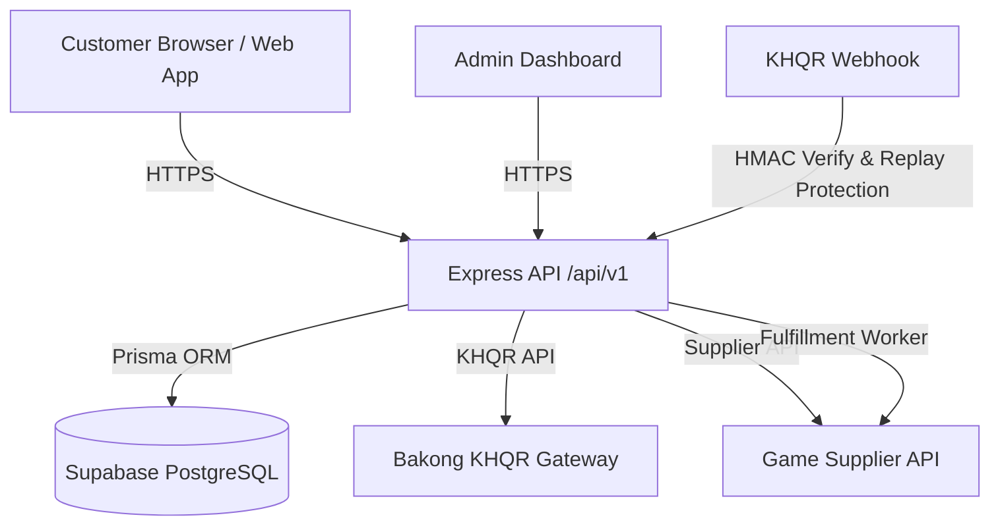

# SN Top-Up — Cambodia Game Top-Up Platform

Production-grade, high-performance game top-up web application for Cambodia supporting Mobile Legends, Free Fire, PUBG Mobile, and more with Bakong KHQR instant payments and automated supplier delivery.

---

## 🏛 Architecture Diagram



---

## 🚀 Quick Start

1. **Clone & Install Dependencies**

   ```bash
   npm install
   ```

2. **Configure Environment Variables**
   Copy `.env.example` to `apps/api/.env` and fill in your Supabase & KHQR credentials:

   ```bash
   cp .env.example apps/api/.env
   ```

3. **Database Migration & Seeding**

   > **Supabase Deployment Note**: Supabase migrations must run **only** via `prisma migrate deploy`. Never use `prisma migrate resolve --applied` unless the SQL migration has been verified and executed directly in the target database.

   ```bash
   npm run db:migrate
   npm run db:seed
   npm run db:verify-rls
   ```

4. **Run Development Servers**
   - API: `npm workspace apps-api run dev` (Port 4000)
   - Web Storefront: `npm workspace apps-web run dev` (Port 5173)

---

## ⚙️ Environment Variables Table

| Variable              | Description                                   | Default / Example                               |
| :-------------------- | :-------------------------------------------- | :---------------------------------------------- |
| `PORT`                | API server port                               | `4000`                                          |
| `DATABASE_URL`        | Supabase pooled connection string (port 6543) | `postgresql://...:6543/postgres?pgbouncer=true` |
| `DIRECT_URL`          | Supabase direct connection string (port 5432) | `postgresql://...:5432/postgres`                |
| `SUPABASE_URL`        | Supabase project URL                          | `https://jihvmgdtwmmivnahedkr.supabase.co`      |
| `KHQR_RBK_TOKEN`      | KHQR gateway auth token                       | `your-khqr-rbk-token`                           |
| `KHQR_WEBHOOK_SECRET` | KHQR webhook signing secret                   | `your-khqr-webhook-secret`                      |

---

## 📦 Monorepo Structure

- `apps/web`: Customer React storefront (Tailwind, i18n English & Khmer).
- `apps/api`: Node.js Express TypeScript API, Prisma ORM, Zod validation, Pino logs.
- `packages/shared`: Shared TypeScript types and constants.
- `docs/`: Architecture specifications and KHQR documentation.
